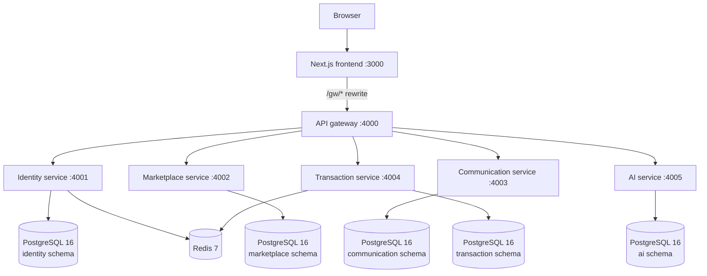

<h1 align="center">
  
</h1>

[](https://nextjs.org/)
[](https://www.typescriptlang.org/)
[](https://docs.docker.com/compose/)
[](https://www.postgresql.org/)
[](https://redis.io/)

A campus-focused marketplace for hostel residents to list items, discover products, negotiate offers, communicate, and coordinate handovers. The application is organized as independently built Next.js services, connected through an API gateway and backed by PostgreSQL and Redis.

> **Demo and payment notice**
>
> This repository is intended for development, learning, and controlled demonstrations. The transaction workflow includes escrow-style states and handover controls, but this is **not a production-cleared escrow or payments system**. Razorpay integration must remain in **test mode** until the integration, security boundaries, refund behaviour, and operational controls have been independently verified. Do not use real funds or sensitive production data.

**Repository:** <https://github.com/adityajshettigar/hostel-marketplace>

## Contents

- [Highlights](#highlights)
- [Architecture](#architecture)
- [Services and local ports](#services-and-local-ports)
- [Technology stack](#technology-stack)
- [Prerequisites](#prerequisites)
- [Local setup](#local-setup)
- [Environment configuration](#environment-configuration)
- [Database initialization](#database-initialization)
- [Run and verify](#run-and-verify)
- [Development workflow](#development-workflow)
- [Testing](#testing)
- [Deployment guidance](#deployment-guidance)
- [Security and known limitations](#security-and-known-limitations)
- [Troubleshooting](#troubleshooting)
- [Contributing](#contributing)

## Highlights

- **Listings and offers:** create and manage listings, browse/filter inventory, and negotiate offers.
- **Hostel-aware identity:** user profiles include hostel context; public-profile responses are designed to avoid exposing private contact and payment details.
- **Authentication:** password hashing, signed access tokens, refresh-token rotation, role-aware administration, and a JWKS endpoint for token verification.
- **Communication:** conversations, messages, notifications, and checks intended to reduce sharing of off-platform contact/payment information.
- **AI-assisted listing tools:** title/category/description assistance, pricing ranges, and recommendations. Suggestions are assistive and should be reviewed by the user; fallback behaviour is available when the optional inference API is not configured.
- **Transaction workflow:** transaction status tracking, handover PIN/QR handling, dispute records, audit events, and payout retry logic.
- **Service-oriented development:** each API service has its own package manifest, Dockerfile, routes, and tests.
- **Containerized local environment:** Docker Compose starts the frontend, gateway, five backend services, PostgreSQL, and Redis.

## Architecture

The browser communicates with the frontend. The frontend routes API requests through the gateway, which forwards requests to the appropriate internal service. The services use one PostgreSQL instance with a separate schema and application role for each service, plus Redis for rate limiting and transaction jobs.



### Request path

1. The browser loads the frontend on port `3000`.
2. Frontend API requests use the `/gw/*` rewrite and reach the gateway on port `4000`.
3. The gateway routes the request to the relevant service and adds the configured internal service key.
4. Services validate requests, apply their authorization rules, and access their own database schema.

The gateway and each service expose health endpoints. Most application routes are authenticated; health and explicitly public identity endpoints are exceptions. In the current configuration, listing browsing through the gateway also requires authentication.

## Services and local ports

| Component | Local port | Responsibility | Database/cache |
|---|---:|---|---|
| Frontend | `3000` | Marketplace UI, login/register, listings, dashboard, purchases, transactions, admin screens | Calls gateway |
| API gateway | `4000` | API routing, JWT checks, internal service-key forwarding, rate limiting, health aggregation | Redis-backed behaviour may be used by downstream services |
| Identity service | `4001` | Registration/login, sessions and refresh, profiles, roles, JWKS | PostgreSQL `identity`; Redis |
| Marketplace service | `4002` | Listings, search, offers, listing status | PostgreSQL `marketplace` |
| Communication service | `4003` | Conversations, messages, message safety checks, notifications, socket endpoint | PostgreSQL `communication` |
| Transaction service | `4004` | Transactions, escrow-style state tracking, handover, disputes, payout/release jobs | PostgreSQL `transaction`; Redis/BullMQ |
| AI service | `4005` | Listing suggestions, price ranges, recommendations | PostgreSQL `ai`; optional Hugging Face API |
| PostgreSQL | `15432` on host | Relational persistence | Named Docker volume |
| Redis | `16379` on host | Cache, rate-limit and background-job support | Named Docker volume |

The PostgreSQL and Redis host ports above are chosen for this Compose setup; containers use `postgres:5432` and `redis:6379` on the internal Docker network. Published ports are for local development only. Do not expose all service or database ports directly to the public internet.

## Technology stack

- **Frontend and API services:** Next.js App Router, TypeScript, Node.js
- **Validation and tests:** Zod, Vitest, service-level integration tests
- **Persistence:** PostgreSQL 16, service-specific schemas and database roles
- **Cache and jobs:** Redis 7, BullMQ for transaction jobs
- **Infrastructure:** Docker, Docker Compose
- **Supporting integrations:** Cloudinary for images, optional Hugging Face inference, Razorpay test-mode integration

## Prerequisites

For the complete containerized application, install:

- Git
- Docker Engine with the Docker Compose plugin (`docker compose`)
- OpenSSL for generating local cryptographic material

For running an individual app directly on your machine, also install Node.js 20 or the version supported by its `package.json`, plus npm.

Check the tools before starting:

```bash
git --version
docker --version
docker compose version
openssl version
node --version   # needed for native development
npm --version    # needed for native development
```

## Local setup

### 1. Clone the repository

```bash
git clone https://github.com/adityajshettigar/hostel-marketplace.git
cd hostel-marketplace
```

### 2. Create the local environment file

```bash
cp .env.example .env
chmod 600 .env
```

Edit `.env` locally and populate the variables required by the services. `.env` contains secrets and must not be committed. `.env.example` is the safe template; keep its secret values empty or use non-secret placeholders.

### 3. Generate local cryptographic values

Generate a new RSA key pair for the local environment and a random internal service key. Keep the private key and all generated secrets out of Git.

```bash
mkdir -p "$HOME/.config/hostel-marketplace/keys"
chmod 700 "$HOME/.config/hostel-marketplace/keys"

openssl genpkey -algorithm RSA \
  -pkeyopt rsa_keygen_bits:2048 \
  -out "$HOME/.config/hostel-marketplace/keys/jwt-private.pem"

openssl pkey \
  -in "$HOME/.config/hostel-marketplace/keys/jwt-private.pem" \
  -pubout \
  -out "$HOME/.config/hostel-marketplace/keys/jwt-public.pem"

openssl rand -hex 32
openssl rand -base64 32
```

Use the first random output as the shared internal service key and the Base64 output as `QR_ENCRYPTION_KEY`. Put the complete private/public PEM contents into the corresponding values in `.env`, preserving the `BEGIN`/`END` lines and newlines in the format accepted by Docker Compose. `JWT_ISSUER` and `JWT_AUDIENCE` must match across services. The identity service is the token signer; production deployments should not give its private signing key to services that only need the public key.

Set `INTERNAL_SERVICE_KEY` and `INTERNAL_SERVICE_API_KEY` to **the exact same random value**. If these values differ, gateway-routed calls to downstream services may fail with `403` responses.

Use unique, strong values for `POSTGRES_PASSWORD` and each service-specific database password. Avoid reusing passwords between applications.

### 4. Configure optional integrations

| Integration | Configuration | Notes |
|---|---|---|
| Image uploads | `NEXT_PUBLIC_CLOUDINARY_CLOUD_NAME`, `NEXT_PUBLIC_CLOUDINARY_UPLOAD_PRESET` | The current frontend upload flow uses a Cloudinary upload preset. Never expose `CLOUDINARY_API_SECRET` as a `NEXT_PUBLIC_*` variable. |
| Razorpay | `RAZORPAY_KEY_ID`, `RAZORPAY_KEY_SECRET`, `RAZORPAY_WEBHOOK_SECRET`, `NEXT_PUBLIC_RAZORPAY_KEY_ID` | Test-mode keys only. The frontend key ID must match the server-side key ID. Live payment use is not supported by this setup. |
| Handover QR encryption | `QR_ENCRYPTION_KEY` | Generate a fresh 32-byte Base64 value for each environment. |
| AI captioning | `HF_API_TOKEN`, optional `HF_CAPTION_MODEL` and `HF_API_URL` | Optional; the AI service should use its documented fallback when no token is configured or inference fails. |
| College domain allow-list | `COLLEGE_EMAIL_DOMAINS` | Comma-separated allowed domains, for example `vitapstudent.ac.in`. Domain allow-listing alone is not proof of verified student identity. |

For the authoritative list of environment variables and their defaults, use the root `.env.example` and [`docs/DEPLOYMENT.md`](docs/DEPLOYMENT.md). Do not paste secrets into issues, commits, screenshots, or chat messages.

## Database initialization

The Compose initialization scripts create the five schemas, service roles, and grants when the PostgreSQL data volume is first initialized. They **do not create each service's application tables**. Each service schema must also be applied before exercising database-backed routes.

### 1. Start PostgreSQL and Redis

```bash
docker compose -f infra/docker-compose.yml --env-file .env up -d postgres redis
```

Wait until both containers report healthy:

```bash
docker compose -f infra/docker-compose.yml --env-file .env ps
```

### 2. Apply the service table schemas

Run from the repository root after the database roles and schemas exist:

```bash
set -eu
for pair in \
  "identity:identity_app" \
  "marketplace:marketplace_app" \
  "communication:communication_app" \
  "transaction:transaction_app" \
  "ai:ai_app"
do
  schema="${pair%%:*}"
  role="${pair##*:}"
  printf 'Applying %s schema as %s\n' "$schema" "$role"
  docker compose -f infra/docker-compose.yml --env-file .env \
    exec -T postgres \
    psql -U "$role" -d hostel_marketplace -v ON_ERROR_STOP=1 \
    < "services/${schema}-service/db/schema.sql"
done
```

If these scripts have already been applied, inspect the database before rerunning them. Do not remove the database volume as a troubleshooting shortcut: `docker compose down -v` permanently deletes the local PostgreSQL and Redis data volumes.

### 3. Build and start the application

```bash
docker compose -f infra/docker-compose.yml --env-file .env up -d --build
```

The first build can take a while. Review service status and logs if a container does not become healthy.

## Run and verify

### Check container status

```bash
docker compose -f infra/docker-compose.yml --env-file .env ps
```

### Check health endpoints

```bash
for port in 4000 4001 4002 4003 4004 4005; do
  printf 'Port %s: ' "$port"
  curl --silent --show-error --output /dev/null \
    --write-out '%{http_code}\n' "http://127.0.0.1:${port}/api/health" || true
done
```

Open the application at **<http://localhost:3000>**. The gateway health endpoint is **<http://localhost:4000/api/health>**.

### Follow logs

```bash
# All services
docker compose -f infra/docker-compose.yml --env-file .env logs -f

# A single service
docker compose -f infra/docker-compose.yml --env-file .env logs -f marketplace-service
```

Press `Ctrl+C` to stop following logs; this does not stop the containers.

### Stop the application

```bash
docker compose -f infra/docker-compose.yml --env-file .env down
```

This stops and removes containers but preserves named volumes. Use `down -v` only when you intentionally want to delete the local persisted data and understand the consequences.

## Development workflow

Each application is an independent Node/Next.js project with its own `package.json`, lockfile, Dockerfile, and tests. You can work on one service while PostgreSQL and Redis remain in Docker.

<details>
<summary><strong>Run a service natively</strong></summary>

1. Start the shared infrastructure from the repository root:

   ```bash
   docker compose -f infra/docker-compose.yml --env-file .env up -d postgres redis
   ```

2. Change to a service directory and install its dependencies. For example, for identity-service:

   ```bash
   cd services/identity-service
   npm ci
   npm run dev
   ```

3. Configure that service's local environment to use the host-mapped database and Redis ports. From a process running directly on the host, use `localhost:15432` for PostgreSQL and `localhost:16379` for Redis. Containers instead use `postgres:5432` and `redis:6379`.

4. Check the scripts in that service's `package.json` for its available test, lint, type-check, and build commands. Do not assume that all services expose identical scripts.

</details>

<details>
<summary><strong>Useful commands</strong></summary>

```bash
# Validate Compose configuration
docker compose -f infra/docker-compose.yml --env-file .env config --quiet

# Rebuild one service and its dependencies if required
docker compose -f infra/docker-compose.yml --env-file .env up -d --build marketplace-service

# Restart one service
docker compose -f infra/docker-compose.yml --env-file .env restart marketplace-service

# Check gateway logs
docker compose -f infra/docker-compose.yml --env-file .env logs --tail=200 gateway
```

</details>

## Testing

Each service contains its own tests. Run them from the service directory and use the scripts declared in that service's `package.json`.

The repository also includes a stack-level smoke test:

```bash
bash scripts/smoke-test.sh
```

**Run the smoke test only against a disposable development/test environment.** It creates users and exercises state-changing listing and transaction paths. Do not point it at production or a shared database with valuable data. Some end-to-end payment and payout assertions require valid Razorpay test-mode credentials and may remain blocked when those external credentials are unavailable; a passing mock-based test does not prove that the live provider integration works.

## Deployment guidance

The Compose setup is intended for local development and controlled demonstrations. For a hosted deployment, follow [`docs/DEPLOYMENT.md`](docs/DEPLOYMENT.md) and configure each service with its own environment and database permissions.

Before making the app public:

1. Put a TLS-terminating reverse proxy or managed edge in front of the application.
2. Expose only the intended public ingress. Do not publish PostgreSQL, Redis, or every microservice port directly to the internet.
3. Inject secrets through the hosting provider's secret manager, and give each service only the secrets it needs.
4. Use a dedicated production database and Redis instance, with backups and a migration/restore plan.
5. Resolve the security and transaction limitations listed below, run the tests against isolated test data, and verify the deployed application end to end.
6. Keep Razorpay in test mode until payment, refund, webhook, and payout behaviour has been independently reviewed and verified.

“Free tier” availability, resource limits, sleep policies, and pricing vary by provider and can change. Confirm current limits with each provider before relying on a zero-cost deployment.

## Security and known limitations

This repository is under active development. The following limitations are important and should be addressed before a public beta or real-money use:

- **Not production-cleared for payments.** The escrow-style workflow is a demonstration, not legally or operationally verified escrow. Razorpay sandbox order creation, webhooks, refunds, and payouts must be tested with valid test credentials; successful unit tests do not establish that the external integration is working.
- **Refund provider integration is incomplete.** A refund-like application state must not be interpreted as proof that Razorpay has returned funds. Verify the provider refund API call and provider-confirmed result before describing a refund as completed.
- **Inventory concurrency needs hardening.** Offer acceptance must reserve stock atomically in the database and be tested under concurrent requests. Without this invariant, multiple buyers may be accepted for the same stock.
- **Network exposure must be restricted.** The local Compose file publishes application and data ports on host interfaces. For hosting, expose the frontend/edge ingress only and keep backend services, PostgreSQL, and Redis private. Apply firewall/network policies as appropriate.
- **Webhook routing needs deliberate configuration.** Razorpay must reach the transaction service's `/api/webhooks/razorpay` endpoint over HTTPS. The current gateway configuration does not proxy that path. Do not solve this by publicly exposing every service port; configure a narrowly scoped, signature-verified reverse-proxy route before relying on remote webhooks.
- **Authentication UX has a known limitation.** The current frontend holds tokens in memory rather than persistent browser storage, so a page reload or newly opened tab may require the user to log in again. Review the refresh-token cookie path and refresh flow before changing this behaviour.
- **Email verification and two-factor authentication are not currently wired into the live signup/login flow.** Do not describe an account as email-verified or protected by new-IP 2FA unless that behaviour has been implemented and tested in the deployed version.
- **Credential hygiene matters.** If a secret has ever been committed, removing the file from the latest snapshot is not enough. Rotate the exposed credential, ensure no secret-bearing history is published, and use a dedicated secret store for hosted deployments.
- **Review dependencies before release.** Re-run the dependency audit and address current advisories for the exact lockfiles and versions being deployed. Audit results become stale when dependencies change.

Security issues should be reported privately to the repository maintainer. Do not open a public issue containing credentials, personal data, exploitable details, or payment information.

## Troubleshooting

| Symptom | Checks |
|---|---|
| A container exits or is unhealthy | Inspect `docker compose ... ps` and `docker compose ... logs <service>`. Check missing required variables in `.env`. |
| Gateway requests return `403` | Confirm `INTERNAL_SERVICE_KEY` and every service's `INTERNAL_SERVICE_API_KEY` match exactly, and check authentication/routing logs. |
| JWT validation fails | Confirm the RSA public key matches the identity service's private signing key; compare issuer and audience settings across services. Do not print key material into logs or chat. |
| Database connection fails | Use `postgres:5432` from containers and `localhost:15432` from the host; verify the relevant role, password, schema, and database URL. |
| Application route returns a database error | Confirm the service's `db/schema.sql` was applied to the correct service role/schema. The init scripts create roles/schemas/grants, not application tables. |
| Listing images fail to upload | Check the public Cloudinary cloud name and upload preset, the built frontend's public environment values, and the actual sanitized browser network error. Never put the Cloudinary API secret in a browser variable. |
| Razorpay integration reports not configured or unauthorized | Verify the test-mode key pair and webhook secret in the provider dashboard. Keep test and live keys separate; never use live keys to debug. |
| A port is already in use | Identify the process/container using it before changing mappings. Do not stop unrelated services blindly. |

## Contributing

1. Create a branch for a focused change.
2. Keep changes scoped to the affected service and its tests.
3. Do not commit `.env`, private keys, tokens, logs, database dumps, or customer data.
4. Add or update regression tests for changes to API contracts, authorization, transaction state, inventory, or security behaviour.
5. Run the relevant service tests and review the final diff before opening a pull request.
6. Document configuration changes in `.env.example` using empty values or safe placeholders only.

## Licence

See [`MIT LICENSE`](LICENSE) for licensing terms.
