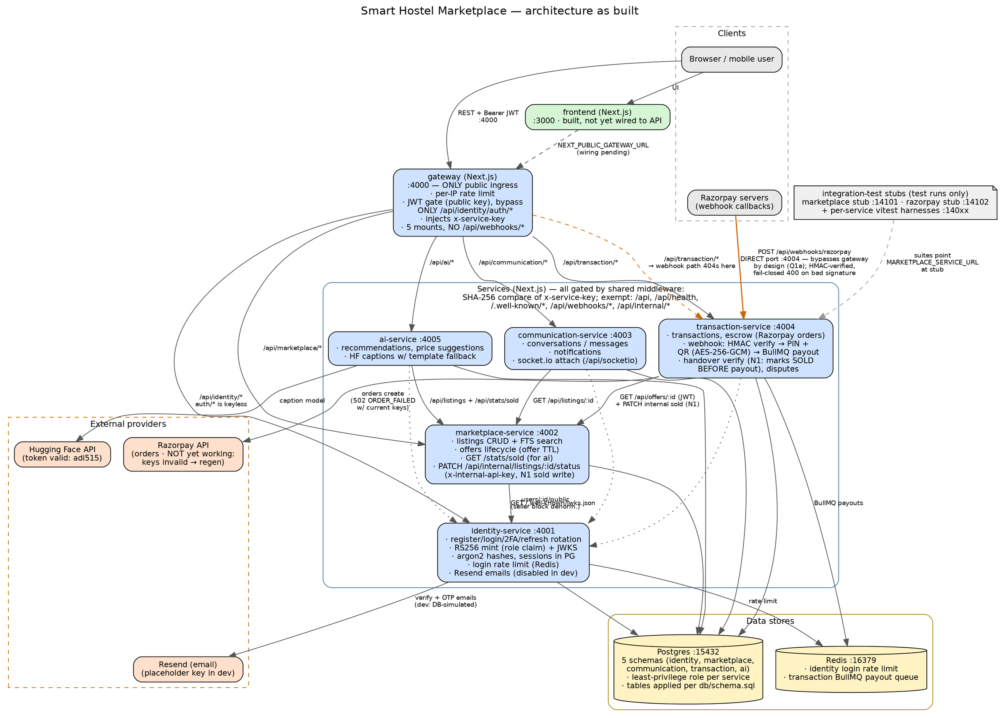

# System Architecture — Graphviz

State: post closeout pass (audit N1–N7 + G1–G3). Ports match `infra/docker-compose.yml`.
Render with: `dot -Tsvg architecture.dot -o architecture.svg` (copy the block below into `architecture.dot`), or paste into https://dreampuf.github.io/GraphvizOnline

## Legend

| Edge style | Meaning |
|---|---|
| solid | runtime request/data path |
| dotted | JWT verification (JWKS fetch) |
| dashed | planned, test-only, or documentation edge |
| bold orange | Razorpay webhook — the one deliberate gateway bypass |

## Facts this diagram encodes (all verified live in the closeout pass)

- **Single public ingress:** gateway `:4000` gates every route with a JWT except `/api/identity/auth/*`; direct service ports reject traffic without `x-service-key` (403).
- **No `/api/webhooks/*` on the gateway (G2/F6, Q1a):** Razorpay must reach transaction-service's port `4004` directly; the route self-authenticates via HMAC and fails closed (400).
- **Browse requires login (Q2):** marketplace `GET /api/listings` is service-layer-public but gateway-JWT-gated.
- **N1 invariant:** on handover verification, transaction marks the listing SOLD in marketplace (internal key) *before* payout; payout failures can't leave a sold listing ACTIVE.
- **Escrow boundary:** with unset/invalid Razorpay keys, escrow-init returns 503 `RAZORPAY_NOT_CONFIGURED` (unset) or 502 `RAZORPAY_ORDER_FAILED` (set but rejected by Razorpay — current state).
